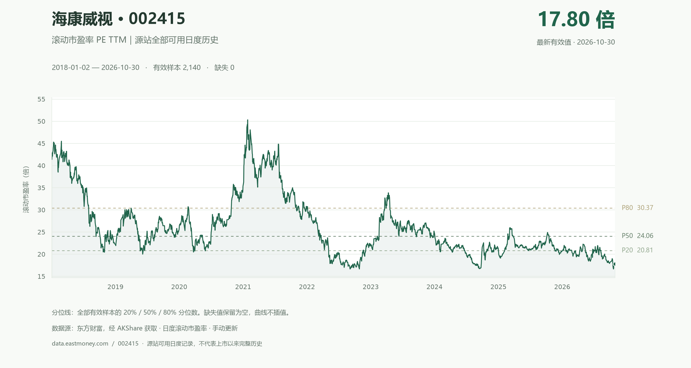
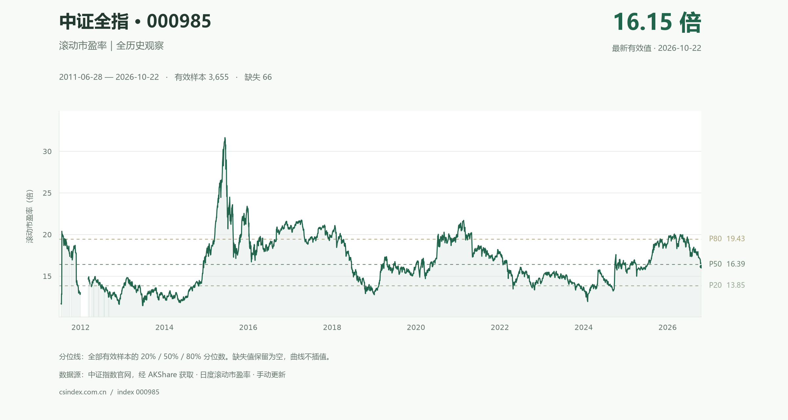

# ASockPEView · 中证全指与海康威视市盈率

使用 AKShare 获取中证全指（000985）和海康威视（002415）的历史滚动市盈率，在本机网页中分别查看。两张图各自保存数据、更新状态和预览图片。

**仅手动更新。** 启动程序、打开页面、切换图表范围均只读取本地缓存，不请求上游数据。没有定时任务、定时刷新或实时行情订阅。

## 海康威视 · 002415



使用东方财富的 **PE(TTM)**，不混用静态 PE。2026-11-02 实测可用日度历史为 **2018-01-02 至 2026-10-30，共 2,140 条**。这不是上市以来的完整历史；“全部”指源站当前可提供的全部日度记录。当前值和覆盖范围以后以图表为准。

## 中证全指 · 000985



上图是仓库保存的静态预览。成功手动更新某张图的数据时只重新生成对应图片；提交并推送后，GitHub 仓库首页才会展示新版。GitHub README 不运行 Python，也不提供直接抓取数据的交互按钮。

## 本机打开

推荐 Python 3.13。Windows 首次使用：

1. 克隆或下载本仓库。
2. 双击 `setup.cmd` 安装依赖（需联网，只安装依赖，不抓取行情）。
3. 双击 `start.cmd`，打开 **http://127.0.0.1:8765**。

仓库附带已验证的历史缓存，首次打开即可看图。之后启动只需 `start.cmd`。用顶部导航切换两张图，海康威视也可以直接打开 **http://127.0.0.1:8765/hikvision.html**。

也可以使用命令行：

```powershell
git clone https://github.com/duoshaga/ASockPEView.git
cd ASockPEView
python -m venv .venv
.\.venv\Scripts\python.exe -m pip install -r requirements.txt
.\.venv\Scripts\python.exe launch.py
```

macOS / Linux：创建虚拟环境后，使用 `.venv/bin/python` 执行相同命令。

## 手动更新

在相应图表页面点击 **“手动更新数据”**，只更新当前这张图。命令行也可以分别执行：

```powershell
.\.venv\Scripts\python.exe update.py --symbol 000985
.\.venv\Scripts\python.exe update.py --symbol 002415
```

程序仅在这时访问对应源站：中证全指首次读取可用完整历史，之后合并最近 35 天的重叠区间；海康威视每次读取源站可用完整历史并接收历史修订。海康会在 AKShare 转换前核验代码、名称、交易所后缀和分页完整性。更新失败保留上次成功数据，页面显示错误。只在一次手动任务进行中查询其完成状态，不会自行发起下一次抓取。

更新后同步到 GitHub：首页图片与数据文件需一并提交、推送。网页按钮本身不会自动提交或推送。

```powershell
git add data/history.json web/data.json web/history.csv docs/pe-history.png
git add data/hikvision-history.json web/hikvision-data.json web/hikvision-history.csv docs/hikvision-pe-history.png
git commit -m "Update manually fetched PE snapshots"
git push
```

仅重新生成首页图片、不联网抓取：

```powershell
.\.venv\Scripts\python.exe preview.py
.\.venv\Scripts\python.exe preview.py --symbol 002415
```

## 图表与数据口径

- 中证全指默认近 10 年，海康威视默认全部可用历史；都可切换 1/3/5/10 年及全部。悬停看数值、拖动缩放、双击复原，支持各自的完整 CSV 下载。
- 来源：[中证指数官网](https://www.csindex.com.cn/zh-CN/indices/index-detail/000985)。使用 [AKShare](https://github.com/akfamily/akshare) 的 `stock_zh_index_hist_csindex`，代码 `000985`，字段 `滚动市盈率`。
- 海康来源：[东方财富估值分析](https://data.eastmoney.com/gzfx/detail/002415.html)。使用 AKShare `stock_value_em(symbol="002415")`，原始字段 `PE_TTM`，输出列 `PE(TTM)`。不拼接百度的抽样日期数据；2018 年以前的日度记录本接口未提供。
- 中证全指首份有效历史从 2011-06-28 开始，早期存在缺口。两图缺失/非正 PE 保留为空，不参与分位计算，图表断线、不插值、不补零。最新日期以页面和预览图为准。
- 分位线按当前区间的有效日度 PE 计算，采用线性插值；百分位表示其中不高于最新可用 PE 的观测值比例。README 图片采用全部有效历史，网页切换区间后分位值会随之变化。
- 中证全指用于观察广泛 A 股市场，不等于全部上市股票的市盈率；直接采用中证官网口径，不混用其他指数、不重新推断权重。
- 数据是源站发布的日度记录，不是盘中实时数据。周末、休市或源站未发布新记录时，手动抓取也不会产生新的数据日期。

## 结构与核验

| 文件 | 用途 |
| --- | --- |
| `server.py` / `launch.py` | 只监听本机的服务及启动入口 |
| `web/` | 交互图表、本地 Plotly 库、JSON 和 CSV |
| `data_pipeline.py` / `update.py` | 数据校验、缓存合并、手动更新 |
| `hikvision_pipeline.py` | 海康威视身份与分页校验、TTM 数据和独立缓存 |
| `data/history.json` | 最后成功的完整缓存 |
| `preview.py` / `docs/pe-history.png` | 生成及展示仓库首页预览 |
| `docs/hikvision-pe-history.png` | 海康威视的仓库首页预览 |
| `tests/` | 数据质量、缓存保护、服务和前端行为验证 |

```powershell
.\.venv\Scripts\python.exe -m unittest discover -s tests -v
node tests/test_frontend.cjs
```

只有最后一项前端测试需要 Node.js，运行图表不需要 Node。绘图库保存在本地，不依赖 CDN。上游公开接口可能变更，出现错误时查看页面状态或 `server.log`。

第三方绘图库许可见 [THIRD_PARTY_NOTICES.md](THIRD_PARTY_NOTICES.md)。
